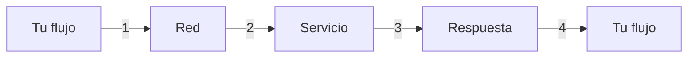
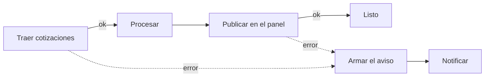
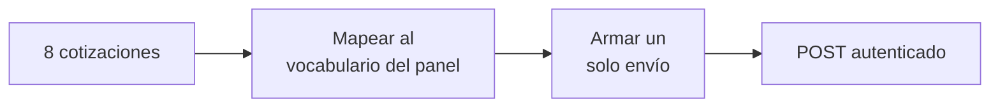

# Seminario de Automatización

<div class="wire"><span></span></div>

<div class="text-xl">Clase 4</div>
<div class="lead mt-1">APIs propias, límites de la plataforma y manejo de errores.</div>

<div class="mute text-sm mt-14">
Tecnicatura Universitaria en Programación<br>
Gonzalo Bechara Balaldi
</div>

<!--
Abrir con la pregunta que quedó de la clase 3: hasta ahora asumimos que los
sistemas que consultamos siempre contestan. Hoy dejamos de asumirlo.
-->

---

## De dónde venimos

<div class="grid grid-cols-2 gap-8 mt-8">

<div>
<div class="ok text-sm mb-3">Ya sabemos</div>
<ul class="mute text-sm">
<li>Modelar un proceso y llevarlo a un flujo</li>
<li>Homogeneizar lo que producen distintos sistemas</li>
<li>Recibir un aviso, validarlo y contestar</li>
<li>Bifurcar con reglas explícitas</li>
</ul>
</div>

<div>
<div class="sig text-sm mb-3">Hoy</div>
<ul class="mute text-sm">
<li>Le hablamos a cualquier servicio, tenga nodo o no</li>
<li>Y dejamos de suponer que nos va a contestar</li>
</ul>
</div>

</div>

<!--
Decirlo con todas las letras: todo lo que construyeron hasta ahora se cae con
un corte de red de treinta segundos, y no se enteran.
-->

---
layout: section
class: section-break
---

# Hablarle a cualquier API

<div class="wire"><span></span></div>

---

## El nodo que sirve para todo

<div class="lead mt-4">
n8n trae cientos de nodos dedicados. Los servicios del mundo son muchos más.
</div>

<div class="grid grid-cols-2 gap-8 mt-8 text-sm">

<div class="box box-ok">
<b class="ok">Nodo dedicado (de marca)</b>
<div class="mute mt-2">
Campos con nombre, credencial resuelta, operaciones listadas. Cuando existe, se usa.
</div>
<div class="mt-3 mute text-xs">Gmail, Slack, Google Sheets, Postgres.</div>
</div>

<div class="box box-sig">
<b class="sig">HTTP Request</b>
<div class="mute mt-2">
El nodo genérico. Cualquier cosa que hable HTTP entra por acá: la API de un proveedor, la de la empresa, la que escribió un compañero.
</div>
<div class="mt-3 mute text-xs">Todo lo demás.</div>
</div>

</div>

<div class="box box-warn mt-8 text-sm">
El techo de la plataforma no es la lista de nodos. Es cualquier cosa que <b class="warn">no habla HTTP</b>, que hoy es muy poco.
</div>

---

## Las cuatro partes de un pedido

<div class="grid grid-cols-2 gap-8 mt-6">

<div>

<div class="tramo"><b class="sig">▸</b><span><b>Método.</b> Qué querés hacer. <code>GET</code> leer, <code>POST</code> crear, <code>PUT</code> y <code>PATCH</code> modificar, <code>DELETE</code> borrar.</span></div>
<div class="tramo"><b class="sig">▸</b><span><b>URL.</b> A qué recurso. Puede llevar parámetros de consulta.</span></div>
<div class="tramo"><b class="sig">▸</b><span><b>Cabeceras.</b> Cómo viene el cuerpo, quién sos, qué aceptás de vuelta.</span></div>
<div class="tramo"><b class="sig">▸</b><span><b>Cuerpo.</b> El dato que mandás. Solo en los métodos que escriben.</span></div>

</div>

<div v-pre>

```http
POST /v1/paneles HTTP/1.1
Host: panel.ejemplo.com
Content-Type: application/json
Authorization: Bearer ****

{
  "panel": "cotizaciones-usd",
  "mercados": 6
}
```

</div>

</div>

<div class="mute text-xs mt-6">
Lo mismo que en los webhooks, pero ahora nosotros iniciamos la solicitud HTTP en vez de recibirla.
</div>

---

## Autenticación por clave

<div class="grid grid-cols-3 gap-4 mt-8 text-sm">

<div class="box">
<b class="sig">En una cabecera</b>
<div class="mute mt-2">Lo más común. <code>Authorization: Bearer ...</code> o una cabecera propia del proveedor.</div>
</div>

<div class="box">
<b class="sig">En la URL</b>
<div class="mute mt-2">Un parámetro de consulta con la clave. Cómodo y peor: queda escrito en todos los registros del camino.</div>
<div class="mute mt-1 text-xs">(Usar cuando el token es de corta duración.)</div>

</div>

<div class="box">
<b class="sig">OAuth2</b>
<div class="mute mt-2">Cuando el servicio actúa en nombre de un usuario.</div>
<div class="mute mt-1 text-xs">(Se ve más adelante.)</div>
</div>

</div>

<div class="box box-warn mt-8 text-sm">
La clave va en una <b class="warn">credencial</b> de n8n, nunca escrita dentro de un campo del nodo. Un nodo con la clave adentro es un nodo que no se puede exportar, ni versionar, ni compartir.
</div>

---

## Qué es una credencial en n8n

<div class="grid grid-cols-2 gap-8 mt-6">

<div>

Un objeto aparte, guardado cifrado, que el nodo <b>referencia por nombre</b>.

<div class="mt-5 text-sm">
<div class="tramo"><b class="sig">▸</b><span><b>Dedicada.</b> El proveedor tiene su tipo propio: Gmail, Slack, Postgres.</span></div>
<div class="tramo"><b class="sig">▸</b><span><b>Genérica.</b> <i>Header Auth</i>, <i>Query Auth</i>, <i>Basic Auth</i>. Para todo lo demás.</span></div>
</div>

<div class="box box-ok mt-5 text-sm">
La genérica de cabecera resuelve casi cualquier API con clave: nombre de la cabecera y valor.
</div>

</div>

<div v-pre>

```text
Credencial: "GitHub del seminario"
Tipo:       Header Auth

  Name   →  Authorization
  Value  →  Bearer github_pat_11A...

El nodo solo dice:
  "usá la credencial GitHub del seminario"
```

</div>

</div>

<div class="mute text-xs mt-6">
Lo que viaja en el JSON exportado es el nombre. El valor se queda en la instancia.
</div>

<!--
Mostrarlo en vivo: crear la credencial, usarla en un nodo, exportar el flujo
y buscar el token en el archivo. No está. Ese es el momento que lo fija.
-->


---

## Los códigos de respuesta HTTP, del lado del emisor

<div class="grid grid-cols-2 gap-8 mt-2 text-sm">

<div>

| Código | Qué significa para vos |
| --- | --- |
| `2xx` | Ok - Salió. Igual hay que mirar el cuerpo. |
| `3xx` | Redirect - La URL que pusiste ya no existe (existió). |
| `400` | Bad request - Mandaste algo mal. |
| `401` | Unauthorized - Credencial ausente. |
| `403` | Forbidden - Credencial sin permiso. |
| `404` | Not found - Lo que buscás no existe. Puede ser tu URL. |
| `409` | Conflict - Algo que querés hacer ya está hecho. |
| `429` | Too many requests - Mandás solicitudes muy rápido. Esperá. |
| `5xx` | Internal server error - Se rompió algo del lado de ellos. |

</div>

<div>

<div class="box box-sig mb-4">
<b class="sig">La línea que importa</b>
<div class="mute mt-2">Los <code>4xx</code> son tuyos: algo del pedido está mal y reintentar no lo arregla. (Excepto 429)</div>
</div>


</div>

</div>

<!--
Es la misma tabla de la clase 3 pero leída al revés. Ahí decidíamos qué
responder; hoy decidimos qué hacer con lo que nos responden.
-->

---

## Qué hacer con la respuesta

<div class="lead mt-4">
El servicio contestó, el nodo está verde, y la mitad de las filas no se pueden usar. Tenemos que hacer lo que vimos las clases anteriores.
</div>

<div class="grid grid-cols-2 gap-x-10 gap-y-3 mt-8 text-sm">

<div class="box"><b class="warn">Un importe llega como texto</b><div class="mute mt-1"><code>"1015.00"</code>. No es un error del proveedor: es su contrato.</div></div>
<div class="box"><b class="warn">Falta una clave</b><div class="mute mt-1">La fila no trae fecha. Publicarla sin fecha es peor que no publicarla.</div></div>
<div class="box"><b class="warn">Un nulo legítimo</b><div class="mute mt-1">Esa casa no tiene precio de compra. Ausente no es inválido.</div></div>
<div class="box"><b class="warn">Un dato imposible</b><div class="mute mt-1">La venta es menor que la compra. Numéricamente válido, comercialmente no.</div></div>

</div>

<div class="box box-sig mt-8 text-sm">
Validar el <b class="sig">código de respuesta</b> y validar el<b class="sig"> cuerpo de la respuesta</b> son dos cosas distintas, y hacen falta las dos.
</div>


---
layout: section
class: section-break
---

# Cuando falla

<div class="wire"><span></span></div>

---

## Qué puede salir mal



<div class="grid grid-cols-4 gap-3 mt-8 text-xs">
<div class="box"><b class="sig">1 · Salir</b><div class="mute mt-1">No resuelve el nombre, no hay ruta, el certificado venció.(Le erraste)</div></div>
<div class="box"><b class="sig">2 · Llegar</b><div class="mute mt-1">El servicio está caído, saturado, o te está limitando.</div></div>
<div class="box"><b class="sig">3 · Volver</b><div class="mute mt-1">Tarda más que el tiempo de espera. (No sabemos si falló o no).</div></div>
<div class="box"><b class="sig">4 · Entender</b><div class="mute mt-1">Contestó, pero con una forma que tu flujo no esperaba.</div></div>
</div>

<div class="box box-warn mt-8 text-sm">
El caso 3 es el peor: <b class="warn">no sabés si pasó o no pasó</b>. Por eso existe la idempotencia que vimos la clase pasada, ahora del lado del que llama.
</div>

<!--
El timeout es el caso que más cuesta. "No me contestó" no es "no lo hizo":
el cobro pudo haberse registrado igual. Reintentar sin clave de idempotencia
es cobrar dos veces.
-->

---

## Transitorio o permanente

<div class="grid grid-cols-2 gap-8 mt-10">

<div class="box box-ok">
<b class="ok">Transitorio</b>
<div class="mute text-sm mt-2">
Si lo intentás de nuevo en diez segundos, probablemente funcione.
</div>
<div class="text-sm mt-4 mute">
<code>429</code>, <code>5xx</code>, tiempos de espera, cortes de red.
</div>
<div class="ok text-xs mt-4">Lo arregla el reintento, sin molestar a nadie.</div>
</div>

<div class="box box-warn">
<b class="warn">Permanente</b>
<div class="mute text-sm mt-2">
Va a fallar igual las próximas mil veces.
</div>
<div class="text-sm mt-4 mute">
URL mal escrita, credencial vencida, cuerpo que no cumple el contrato.
</div>
<div class="warn text-xs mt-4">Reintentarlo son tres fallas en vez de una.</div>
</div>

</div>


<!--
Preguntar al aula por casos de cada lado antes de mostrar la lista.
Sale rápido y fija la idea.
-->

---

## Reintentar

<div class="grid grid-cols-2 gap-8 mt-6">

<div>

Se configura en el nodo, no se programa: <b>Settings → Retry On Fail</b>.

<div class="mt-5 text-sm">
<div class="tramo"><b class="sig">▸</b><span><b>Cuántas veces.</b> Tres alcanza casi siempre.</span></div>
<div class="tramo"><b class="sig">▸</b><span><b>Cuánto esperar.</b> Cinco segundos entre intentos.</span></div>
</div>

<div class="box box-warn mt-5 text-sm">
El reintento dispara con <b class="warn">cualquier</b> error, no solo con los transitorios. No hay filtro por código.
</div>

</div>

<div>

<div class="box box-sig text-sm">
<b class="sig">Va primero</b>
<div class="mute mt-2">
Antes de construir ramas de error, absorbé lo transitorio. Así la rama de error dispara solo cuando el problema es real.
</div>
</div>

<div class="box box-warn text-sm mt-4">
<b class="warn">Cuidado al escribir</b>
<div class="mute mt-2">
Reintentar un <code>GET</code> es gratis. Reintentar un <code>POST</code> que crea algo puede crearlo dos veces, salvo que el otro lado sepa descartar duplicados.
</div>
</div>

</div>

</div>

<!--
El último punto cierra el círculo con la clase 3: allá defendíamos la
idempotencia como receptores, acá la necesitamos como emisores.
-->

---

## La salida de error son dos pasos

<div class="lead mt-4">
Es la forma más común de "manejar" errores sin manejarlos.
</div>

<div class="mt-8 text-sm">

<div class="tramo">
<b class="sig">1</b>
<span>En el nodo: <b>Settings → On Error → Continue (using error output)</b>. Eso <b>crea</b> la segunda salida.</span>
<em>habilitar</em>
</div>

<div class="tramo">
<b class="sig">2</b>
<span>Cablear esa salida a algún lado que haga algo con el error.</span>
<em>conectar</em>
</div>

</div>

<div class="grid grid-cols-3 gap-4 mt-8 text-xs">
<div class="box box-warn"><b>Solo el 1</b><div class="mute mt-1">El error se descarta en silencio y la ejecución figura como exitosa. El peor de los tres.</div></div>
<div class="box box-warn"><b>Solo el 2</b><div class="mute mt-1">La salida nunca dispara. El flujo se corta como si no hubiera nada.</div></div>
<div class="box box-ok"><b>Los dos</b><div class="mute mt-1">El error baja por la segunda salida hasta tu rama.</div></div>
</div>

<!--
Mostrarlo en vivo: habilitar el On Error, ver aparecer la segunda salida en
el lienzo, y recién ahí cablearla. Verlo aparecer es lo que lo fija.
-->

---

## Una sola rama de aviso



<div class="grid grid-cols-2 gap-6 mt-8 text-sm">
<div class="box box-sig">
<b class="sig">Todas las salidas de error al mismo lugar</b>
<div class="mute mt-1">El lienzo queda legible y la lógica del aviso se escribe una sola vez.</div>
</div>
<div class="box box-ok">
<b class="ok">El aviso dice qué pasó</b>
<div class="mute mt-1">Qué nodo, qué código, si conviene reintentar, y qué mirar. Un aviso que dice "falló el flujo" no sirve para nada.</div>
</div>
</div>


---

## El registro de ejecuciones

<div class="lead mt-4">
Cuando algo falla en producción, esto es lo único que tenés.
</div>

<div class="grid grid-cols-2 gap-x-10 gap-y-3 mt-8 text-sm">

<div class="box"><b class="sig">Entrada y salida de cada nodo</b><div class="mute mt-1">Con qué llegó y con qué se fue. Ahí se ve dónde se rompió la forma del dato.</div></div>
<div class="box"><b class="sig">Cuántos intentos hubo</b><div class="mute mt-1">Si el reintento estaba puesto, se ve cada uno.</div></div>
<div class="box"><b class="sig">El error completo</b><div class="mute mt-1">Código, cuerpo de la respuesta y nodo. Leer el cuerpo antes que el código.</div></div>
<div class="box"><b class="sig">Manual o de producción</b><div class="mute mt-1">Filtrar por eso ahorra la mitad del trabajo.</div></div>

</div>

<div class="box box-warn mt-8 text-sm">
Las ejecuciones <b class="warn">no son eternas</b>. La instancia las va borrando. Si algo importa de verdad, se guarda en otro lado, no en el registro.
</div>

<!--
Abrir una ejecución fallida de verdad y recorrerla. Es la herramienta que
más van a usar en su vida laboral y la que menos se enseña.
-->

---
layout: section
class: section-break
---

# Caso de uso

<div class="wire"><span></span></div>

---

## Un panel de cotizaciones

<div class="lead mt-4">
Una API pública publica las cotizaciones del dólar. Hay que armar un panel con eso y dejarlo publicado en algún lado que se pueda abrir.
</div>

<div class="grid grid-cols-2 gap-8 mt-8 text-sm">

<div class="box box-ok">
<b class="ok">El origen · sin credencial</b>
<div class="mute mt-2">
Una API pública, gratuita y abierta. Devuelve una lista de casas de cambio con compra, venta y fecha.<br><br>
Cualquiera la consulta. Nadie sabe quién sos.
</div>
</div>

<div class="box box-sig">
<b class="sig">El destino · con credencial</b>
<div class="mute mt-2">
La API de GitHub. El panel se publica como un archivo con su propia dirección, que se abre en el navegador.<br><br>
Escribir exige decir quién sos.
</div>
</div>

</div>

<div class="box box-warn mt-8 text-sm">
Ninguna de las dos tiene nodo dedicado para lo que necesitamos. Sin el nodo genérico, este flujo no existe.
</div>

<div class="mute text-xs mt-4">
No es casualidad que la solicitud de  escritura sea la que pide credencial. Leer algo público es gratis; dejar algo escrito, no.
</div>

<!--
Elegí a propósito una API argentina y real. Que vean que el ejercicio no es
de juguete: eso que devuelve son las cotizaciones de hoy.
-->

---

## Qué hay que producir

<div class="mt-6 text-sm">

<div class="tramo"><b>1</b><span>Traer las cotizaciones y <b>mirar</b> lo que vino</span><em>lectura</em></div>
<div class="tramo"><b>2</b><span>Separar lo publicable de lo que no, con el motivo escrito</span><em>validación</em></div>
<div class="tramo"><b>3</b><span>Traducir al vocabulario del panel</span><em>mapeo</em></div>
<div class="tramo"><b>4</b><span>Publicar <b>una sola vez</b>, autenticado, con todo junto</span><em>escritura</em></div>
<div class="tramo"><b>5</b><span>Una rama de error que avise qué pasó y si conviene reintentar</span><em>fallas</em></div>

</div>


<!--
Escribir el 8 en el pizarrón apenas empiecen. Es el número contra el que van
a chequear toda la práctica.
-->

---
layout: section
class: section-break
---

# Práctica guiada

<div class="wire"><span></span></div>

---

## Paso 0 — Obtener nuestro token (uno por persona)

<div class="mt-6 text-sm">

<div class="tramo"><b>a</b><span>En GitHub: Settings → Developer settings → <b>Fine-grained tokens</b></span><em>dos minutos</em></div>
<div class="tramo"><b>b</b><span>Un solo permiso: <b>Account → Gists → Read and write</b>. Nada más</span><em>mínimo</em></div>
<div class="tramo"><b>c</b><span>En n8n, credencial <b>Header Auth</b>: <code>Authorization</code> / <code>Bearer &lt;token&gt;</code></span><em>una vez</em></div>

</div>


---

## Paso 1 — Traer y mirar

<div class="mt-6 text-sm">

<div class="tramo"><b>a</b><span>Importar el template. El nodo de entrada ya está armado</span><em>listo</em></div>
<div class="tramo"><b>b</b><span>Ejecutar y abrir la salida: ocho filas, con sus campos</span><em>observar</em></div>
<div class="tramo"><b>c</b><span>Recorrerlas de a una y anotar cuáles no se podrían publicar</span><em>a mano</em></div>

</div>


<!--
Este paso parece perdido y no lo es: el que no mira los datos primero,
después escribe un validador que valida lo que él imaginó.
-->

---

## Paso 2 — Mapear y publicar



<div class="box box-warn mt-8 text-sm">
Sin el nodo que junta, el HTTP se ejecuta <b class="warn">una vez por item</b> y crea seis publicaciones de una fila cada una. Es la lección de los items de la clase 1, y hoy además gasta seis veces la cuota.
</div>

<div class="grid grid-cols-3 gap-4 mt-6 text-xs">
<div class="box">
<b class="sig">Dos cabeceras más</b>
<div class="mute mt-1">El formato que aceptás y la versión de la API. Ninguna de las dos es la credencial.</div>
</div>
<div class="box box-ok">
<b class="ok">Cómo saber que salió bien</b>
<div class="mute mt-1">La respuesta trae una dirección. Abrila: ahí está tu panel.</div>
</div>
</div>


---

## Paso 3 — La rama de error

<div class="mt-6 text-sm">

<div class="tramo"><b>a</b><span>En los <b>dos</b> nodos HTTP: On Error → Continue (using error output)</span><em>habilitar</em></div>
<div class="tramo"><b>b</b><span>Cablear las dos salidas de error al mismo nodo de aviso</span><em>conectar</em></div>
<div class="tramo"><b>c</b><span>Armar el aviso: qué nodo, qué código, transitorio o permanente</span><em>describir</em></div>
<div class="tramo"><b>d</b><span>Reintento en los dos: tres intentos, cinco segundos</span><em>absorber</em></div>

</div>

<div class="box box-sig mt-8 text-sm">
El aviso tiene que servirle a alguien que <b class="sig">no estaba mirando</b>. Si dice "error en el flujo", no sirve.
</div>

<!--
Pedirles que escriban el aviso pensando en ellos mismos un martes a las
tres de la mañana. Cambia bastante lo que ponen.
-->

---

## Paso 4 — Romperlo a propósito

<div class="lead mt-4">
Con el flujo andando, provocar tres fallas distintas y mirar el registro cada vez.
</div>

<div class="grid grid-cols-3 gap-4 mt-8 text-sm">

<div class="box box-warn">
<b>Un carácter menos en el token</b>
<div class="mute mt-2">Editar la credencial y romperla. <code>401</code>. ¿Cuántas veces reintentó antes de rendirse, y para qué sirvió?</div>
</div>

<div class="box box-warn">
<b>Un tiempo de espera de 1 ms</b>
<div class="mute mt-2">Forzar que el pedido no llegue a volver. ¿Se publicó el panel del otro lado o no?</div>
</div>

<div class="box box-warn">
<b>Un campo renombrado</b>
<div class="mute mt-2">Cambiar <code>venta</code> por <code>precio</code> en la validación. El flujo no falla y el resultado queda mal.</div>
</div>

</div>

<div class="box box-sig mt-8 text-sm">
En la tercera: esposible que <b class="sig">ningún nodo se ponga en rojo</b> y el panel queda publicado con datos incorrectos. No todas las fallas son errores.
</div>

<!--
La primera además muestra el reintento trabajando en contra: tres 401 en vez
de uno. Dejar la tercera para el final y no adelantarla.
-->

---

## Lo que probablemente falle

<div class="grid grid-cols-2 gap-6 mt-8 text-sm">

<div class="box box-warn"><b><code>401</code> con el token recién creado</b><div class="mute mt-1">Token mal pegado en la credencial, o se copió con un espacio al final.</div></div>
<div class="box box-warn"><b><code>403</code> al publicar</b><div class="mute mt-1">El token está bien pero le falta el permiso de escritura. Autenticado no es autorizado.</div></div>
<div class="box box-warn"><b>Se publicaron seis paneles</b><div class="mute mt-1">Falta juntar los items antes del HTTP. Un envío por item.</div></div>
<div class="box box-warn"><b>La rama de error nunca disparó</b><div class="mute mt-1">Está cableada pero falta el On Error. O está el On Error y no se cableó.</div></div>
<div class="box box-warn"><b>El aviso llegó vacío</b><div class="mute mt-1">Se buscó el error en la raíz del item. Viene en <code>$json.error</code>.</div></div>

</div>

---

## Cierre

<div class="grid grid-cols-2 gap-10 mt-8">

<div>
<div class="sig text-sm mb-3">Hoy vimos</div>
<ul class="mute text-sm">
<li>El nodo HTTP como comodín para cualquier servicio</li>
<li>Credenciales: dónde va la clave y dónde nunca</li>
<li>Transitorio contra permanente, y qué reintentar</li>
<li>Que la salida de error son dos pasos, no uno</li>
<li>Que una falla silenciosa es peor que un nodo en rojo</li>
</ul>
</div>


</div>