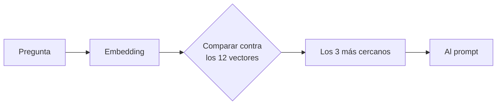
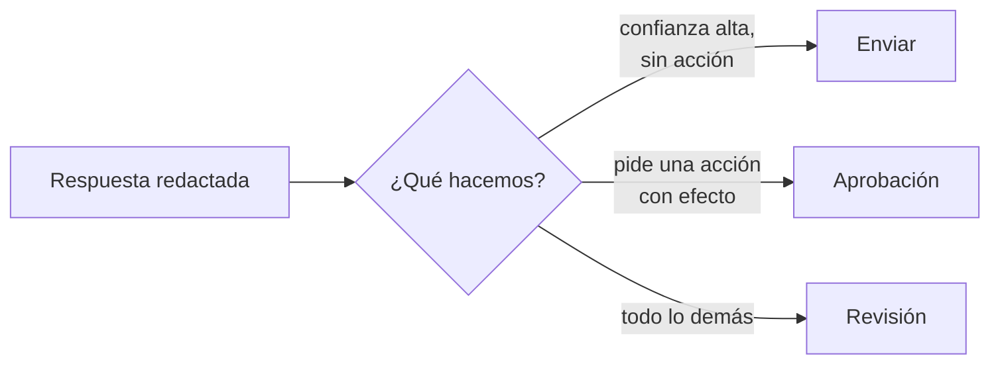

# Seminario de Automatización

<div class="wire"><span></span></div>

<div class="text-xl">Clase 6</div>
<div class="lead mt-1">Recuperación aumentada e intervención humana.</div>

<div class="mute text-sm mt-14">
Tecnicatura Universitaria en Programación<br>
Gonzalo Bechara Balaldi
</div>

<!--
Abrir con lo que quedó abierto: el modelo clasificó bien los mensajes pero no
sabe nada nuestro. Hoy le damos lo nuestro, y ponemos a alguien a mirar.
-->

---

## De dónde venimos

<div class="grid grid-cols-2 gap-8 mt-8">

<div>
<div class="ok text-sm mb-3">La clase pasada</div>
<ul class="mute text-sm">
<li>El modelo como un nodo más</li>
<li>Salida estructurada</li>
<li>Guardia determinista antes de preguntar</li>
<li>Validar lo que devuelve</li>
</ul>
</div>

<div>
<div class="sig text-sm mb-3">Hoy</div>
<ul class="mute text-sm">
<li>Le damos información que solo tenemos nosotros</li>
<li>Y pasamos de clasificar a redactar</li>
</ul>
</div>

</div>

<div class="box box-warn mt-10 text-sm">
Clasificar mal manda un mensaje a la cola equivocada. Redactar mal <b class="warn">le miente a un cliente en nuestro nombre</b>. Sube el costo del error, y por eso sube el control.
</div>

<!--
Esa frase es el encuadre de la clase entera. El salto de impacto justifica
todo lo que viene: umbrales, validación, revisión humana.
-->

---
layout: section
class: section-break
---

# Recuperar

<div class="wire"><span></span></div>

---

## El modelo no sabe lo tuyo

<div class="lead mt-4">
Sabe mucho del mundo y nada de tu empresa. Tus plazos, tus precios y tus políticas son desconocidas.
</div>

¿Cómo lo podemos solucionar?
<div class="grid grid-cols-3 gap-4 mt-8 text-sm">
<div class="box box-warn">
<b class="warn">Reentrenarlo</b>
<div class="mute mt-2">Caro, lento, y hay que rehacerlo cada vez que cambia una política.</div>
</div>

<div class="box box-warn">
<b class="warn">Meterle todo en el prompt</b>
<div class="mute mt-2">Funciona con muy poca información, llena a todos los prompts de contexto que quizás no use.</div>
</div>

<div class="box box-ok">
<b class="ok">Recuperar lo que hace falta</b>
<div class="mute mt-2">Buscar los pocos fragmentos que tienen que ver con la pregunta y pasarle solo esos.</div>
</div>

</div>

<div class="box box-sig mt-8 text-sm">
La tercera es la recuperación aumentada.
</div>


---

## Qué es un embedding

<div class="grid grid-cols-2 gap-8 mt-6">

<div>

Un modelo convierte un texto en una lista de números. Esa lista es una dirección en un espacio de muchas dimensiones.

<div class="box box-sig mt-5 text-sm">
Dos textos que quieren decir lo mismo <b class="sig">apuntan para el mismo lado</b>, aunque no compartan ni una palabra.
</div>

<div class="mute text-sm mt-5">
"¿Cuánto tardan en llegar?" y "Plazos de entrega" no comparten nada, y sin embargo quedan cerca.
</div>

</div>

<div v-pre>

```json
{
  "embedding": {
    "values": [
      0.0134, -0.0271, 0.0455,
      -0.0098, 0.0312, ...
    ]
  }
}
```

</div>

</div>

<div class="mute text-xs mt-6">
Son 768 números por fragmento. No hay nada que interpretar ahí adentro: lo único que se hace con ellos es medir ángulos.
</div>

<!--
Resistir la tentación de explicar cómo se entrenan. No hace falta y se come
la clase. Alcanza con "texto adentro, dirección afuera".
-->

---

## Buscar por significado



<div class="grid grid-cols-2 gap-6 mt-8 text-sm">

<div class="box box-sig">
<b class="sig">La medida</b>
<div class="mute mt-1">El coseno del ángulo entre los dos vectores. Va de -1 a 1: cuanto más cerca de 1, más parecido el significado.</div>
</div>

<div class="box box-warn">
<b class="warn">El mismo modelo de los dos lados</b>
<div class="mute mt-1">Si indexás con uno y consultás con otro, los vectores no se comparan. No da error: da resultados sin sentido.</div>
</div>

</div>

---

## El tamaño del fragmento

<div class="grid grid-cols-3 gap-4 mt-10 text-sm">

<div class="box box-warn">
<b class="warn">Muy chico</b>
<div class="mute mt-2">Una oración suelta. Recupera bien pero le falta el contexto para responder.</div>
</div>

<div class="box box-ok">
<b class="ok">Justo</b>
<div class="mute mt-2">Una política completa y corta. Entra entera en la respuesta y se entiende sola.</div>
</div>

<div class="box box-warn">
<b class="warn">Muy grande</b>
<div class="mute mt-2">Un documento entero. El vector queda promediado entre veinte temas y no se parece a ninguna pregunta.</div>
</div>

</div>

<div class="lead mt-10">
Un fragmento es lo que le pasarías a una persona para que responda esa pregunta y nada más.
</div>

<!--
La base de hoy ya viene partida. Vale la pena decir que en la vida real ese
recorte es la mitad del trabajo y la parte que más impacto tiene.
-->

---

## El umbral de recuperación

<div class="lead mt-4">
Si lo más parecido que hay en la base no se parece lo suficiente, la respuesta correcta es que no tenemos con qué responder.
</div>

<div class="grid grid-cols-2 gap-8 mt-8 text-sm">

<div class="box box-warn">
<b class="warn">Sin umbral</b>
<div class="mute mt-2">
La búsqueda siempre devuelve los tres más cercanos, aunque los tres no tengan nada que ver. El modelo recibe basura y contesta igual.
</div>
</div>

<div class="box box-ok">
<b class="ok">Con umbral</b>
<div class="mute mt-2">
Si no encontramos nada debajo del umbral contestamos que no sabemos o enviamos el caso va directo a una persona.
</div>
</div>

</div>

<div class="box box-sig mt-8 text-sm">
El número se <b class="sig">calibra mirando los puntajes reales</b>, no se elige de antemano. Depende del modelo de embeddings y del idioma.
</div>

<!--
Esta es la primera de las tres compuertas de hoy. Las otras dos son la
confianza del modelo y la validación de lo que citó.
-->

---
layout: section
class: section-break
---

# Confiar

<div class="wire"><span></span></div>

---

## Alucinaciones

<div class="lead mt-4">
Es la propiedad más peligrosa de un modelo de lenguaje, y no se arregla con un prompt mejor.
</div>

<div class="grid grid-cols-2 gap-x-10 gap-y-3 mt-8 text-sm">

<div class="box"><b class="warn">Inventa la política</b><div class="mute mt-1">Le preguntan por algo que no está en la base y redacta un plazo verosímil.</div></div>
<div class="box"><b class="warn">Completa lo que falta</b><div class="mute mt-1">El fragmento dice la mitad y el modelo pone la otra mitad de su cosecha.</div></div>
<div class="box"><b class="warn">Cita una fuente que no recibió</b><div class="mute mt-1">Devuelve un identificador de fragmento que nunca estuvo en el prompt.</div></div>
<div class="box"><b class="warn">Elige entre dos versiones</b><div class="mute mt-1">Le pasás dos fragmentos que se contradicen y se queda con uno, sin avisar.</div></div>

</div>

<div class="box box-sig mt-8 text-sm">
Ninguna es fácil de detectar. Requiere de revisión experta.
</div>


---

## Pedirle la confianza

<div class="grid grid-cols-2 gap-8 mt-6">

<div>

Entre los campos de la salida estructurada va uno más: cuán seguro está el propio modelo.

<div class="box box-ok mt-5 text-sm">
No es una medida exacta, y aun así separa bastante bien lo que se puede mandar de lo que hay que mirar.
</div>

<div class="box box-warn mt-4 text-sm">
Un modelo puede estar muy seguro y equivocado. La confianza es <b class="warn">una señal más</b>, no una garantía.
</div>

</div>

<div v-pre>

```json
{
  "respuesta": "En Rosario entregamos
    dentro de las 48 horas hábiles.",
  "confianza": 0.92,
  "fragmentos_usados": ["kb-01"],
  "requiere_accion": false,
  "falta_informacion": false
}
```

</div>

</div>

<!--
Señalar los dos últimos campos: son los que convierten la salida en algo
que el flujo puede rutear sin volver a preguntarle al modelo.
-->

---

## El control que atrapa la invención

<div class="lead mt-4">
De las cuatro formas de inventar, hay una que se detecta con una línea de código.
</div>

<div class="grid grid-cols-2 gap-8 mt-8 text-sm">

<div class="box box-sig">
<b class="sig">Lo que se le pasó</b>
<div class="mute mt-2">
El flujo sabe exactamente qué fragmentos le puso en el prompt: <code>kb-01</code>, <code>kb-06</code>, <code>kb-05</code>.
</div>
</div>

<div class="box box-ok">
<b class="ok">Lo que dice haber usado</b>
<div class="mute mt-2">
Viene en <code>fragmentos_usados</code>. Si aparece alguno que no está en la lista de arriba, la respuesta no está respaldada.
</div>
</div>

</div>

<div class="box box-warn mt-8 text-sm">
Que cite bien no prueba que la respuesta sea correcta. Que cite mal <b class="warn">sí prueba</b> que está alucinando.
</div>

<!--
Es una prueba de una sola dirección y conviene decirlo así. No detecta todo:
detecta un caso, mecánicamente, gratis y sin falsos positivos.
-->

---

## Cuando la base se contradice

<div class="lead mt-4">
Las políticas cambian. Las versiones viejas quedan en la carpeta compartida.
</div>

<div class="grid grid-cols-2 gap-6 mt-8 text-sm">

<div class="box box-warn">
<b class="warn">Versión anterior</b>
<div class="mute mt-2">15 días para devolver. El envío lo paga el cliente.</div>
</div>

<div class="box box-ok">
<b class="ok">Versión vigente</b>
<div class="mute mt-2">30 días para devolver. El envío lo paga la empresa.</div>
</div>

</div>

<div class="box box-sig mt-8 text-sm">
Las dos están en la base y las dos se recuperan juntas. El modelo <b class="sig">no tiene que elegir</b>: tiene que avisar que hay una contradicción y bajar la confianza.
</div>

<div class="mute text-xs mt-4">
La fecha de vigencia va en cada fragmento por esto. No para que el modelo decida, sino para que la persona que revisa vea cuál es cuál.
</div>

<!--
Preguntar al aula qué haría un humano nuevo en el puesto con esos dos
papeles sobre el escritorio. La respuesta es "pregunto", y eso es lo que
queremos que haga el flujo.
-->

---
layout: section
class: section-break
---

# Intervenir

<div class="wire"><span></span></div>

---

## Tres destinos, no dos



<div class="grid grid-cols-3 gap-4 mt-8 text-xs">
<div class="box box-ok"><b class="ok">Enviar</b><div class="mute mt-1">Sale solo. Es la única rama sin nadie mirando, y por eso es la más exigente.</div></div>
<div class="box box-sig"><b class="sig">Aprobación</b><div class="mute mt-1">El borrador está listo. Decide una persona.</div></div>
<div class="box box-warn"><b class="warn">Revisión</b><div class="mute mt-1">Baja confianza, contradicción, invención o salida inválida.</div></div>
</div>


---

## Acciones con efecto

<div class="lead mt-4">
Responder una consulta no cambia nada. Cancelar un pedido, devolver dinero o dar de baja, sí.
</div>

<div class="grid grid-cols-2 gap-8 mt-8 text-sm">

<div class="box box-warn">
<b class="warn">La regla</b>
<div class="mute mt-2">
Ninguna acción con efecto se ejecuta sin que una persona la apruebe, por más alta que sea la confianza.
</div>
</div>

<div class="box box-ok">
<b class="ok">Y mientras tanto</b>
<div class="mute mt-2">
El borrador se redacta igual. La persona aprueba o corrige en vez de escribir desde cero.
</div>
</div>

</div>

<div class="box box-sig mt-8 text-sm">
La automatización no desaparece cuando hace falta una persona: <b class="sig">le deja el trabajo hecho</b> y se queda esperando la aprobación.
</div>

<!--
Ese es el matiz que distingue "human in the loop" de "lo hace un humano".
Vale la pena insistir: el 90% del trabajo ya está hecho cuando la persona
llega.
-->

---

## La cola de revisión es parte del producto

<div class="grid grid-cols-2 gap-8 mt-6 text-sm">

<div>
<div class="warn mb-3">Una cola que no sirve</div>
<ul class="mute">
<li>Llega el correo crudo, sin nada más</li>
<li>No dice por qué cayó ahí</li>
<li>No trae el borrador</li>
<li>Nadie la mira a los tres días</li>
</ul>
</div>

<div>
<div class="ok mb-3">Una cola que sirve</div>
<ul class="mute">
<li>El motivo, escrito</li>
<li>Los fragmentos que se recuperaron, con su puntaje</li>
<li>El borrador que el modelo propuso</li>
<li>Un botón de aprobar y uno de corregir</li>
</ul>
</div>

</div>

<div class="box box-warn mt-8 text-sm">
Si la cola no se mira, el sistema no tiene revisión humana: Es un <b class="warn">tacho de basura con otro nombre</b>.
</div>

<!--
Es el mismo punto que la cuarentena de la clase 2 y la cola de revisión de
la clase 3. Tercera vez que aparece, y ahora con un humano del otro lado.
-->

---
layout: section
class: section-break
---

# Caso de uso

<div class="wire"><span></span></div>

---

## Un asistente de correos

<div class="lead mt-4">
La misma tienda de la clase pasada. Ahora hay que contestarles, no solo clasificarlos.
</div>

<div class="grid grid-cols-2 gap-8 mt-8 text-sm">

<div class="box">
<b class="sig">La base de conocimiento</b>
<div class="mute mt-2">
Doce fragmentos de políticas: entregas, devoluciones, garantía, pagos, facturación, sucursales, descuentos, bajas.
</div>
<div class="mt-3 warn text-xs">Dos de los doce se contradicen entre sí.</div>
</div>

<div class="box">
<b class="sig">Los correos</b>
<div class="mute mt-2">
Nueve consultas reales. Algunas están cubiertas por la base, otras no, y una pide una acción con efecto.
</div>
<div class="mt-3 warn text-xs">Uno intenta darle órdenes al asistente.</div>
</div>

</div>

<div class="box box-warn mt-8 text-sm">
Del otro lado hay un cliente leyendo. Una respuesta inventada nos puede generar problemas legales. ¿Qué pasa si le decimos al cliente que el envío es gratis y luego no lo es?
</div>

<!--
Leer en voz alta el correo de devoluciones y el de criptomonedas. El primero
tiene respuesta contradictoria en la base; el segundo no tiene ninguna.
-->

---

## Qué hay que producir

<div class="mt-6 text-sm">

<div class="tramo"><b>1</b><span>Un <b>índice</b>: cada fragmento con su vector</span><em>una vez</em></div>
<div class="tramo"><b>2</b><span>Para cada correo, los <b>tres fragmentos</b> más cercanos y su puntaje</span><em>recuperación</em></div>
<div class="tramo"><b>3</b><span>Un <b>umbral</b> calibrado con los puntajes que ven, no elegido de antemano</span><em>compuerta</em></div>
<div class="tramo"><b>4</b><span>Una <b>respuesta redactada</b> solo con lo que dicen esos fragmentos</span><em>generación</em></div>
<div class="tramo"><b>5</b><span>Tres colas: <b>enviar</b>, <b>aprobación</b> y <b>revisión</b>, con el motivo escrito</span><em>ruteo</em></div>

</div>

<div class="box box-sig mt-8 text-sm">
La pregunta con la que se cierra el ejercicio: de los nueve, <b class="sig">¿a cuántos le mandarías la respuesta sin leerla?</b>
</div>

<!--
Esa pregunta va al pizarrón al principio y se responde al final. Casi nadie
dice nueve, y ahí es donde se entiende para qué sirve todo lo de hoy.
-->

---
layout: section
class: section-break
---

# Práctica guiada

<div class="wire"><span></span></div>

---

## Paso 0 — Dos credenciales, una clave

<div class="mt-6 text-sm">

<div class="tramo"><b>a</b><span>La misma clave gratuita de AI Studio de la clase pasada</span><em>ya la tienen</em></div>
<div class="tramo"><b>b</b><span>Credencial <b>Google Gemini (PaLM) API</b> para el subnodo del modelo</span><em>ya la tienen</em></div>
<div class="tramo"><b>c</b><span>Credencial <b>Header Auth</b> nueva: nombre <code>x-goog-api-key</code>, valor la misma clave</span><em>nueva</em></div>
<div class="tramo"><b>d</b><span>Seleccionarla en los dos nodos de embeddings</span><em>listo</em></div>

</div>

<div class="box box-sig mt-8 text-sm">
Son dos credenciales porque el nodo HTTP no usa el mismo tipo que el subnodo del modelo. <b class="sig">La clave es una sola.</b> <span class="mute">(Es un tecnicismo de N8N)</span>
</div>

---

## Paso 1 — Indexar

<div class="mt-6 text-sm">

<div class="tramo"><b>a</b><span>Ejecutar el template y abrir la salida de <b>Embeber fragmentos</b></span><em>mirar</em></div>
<div class="tramo"><b>b</b><span>Contar: doce items, y 768 números en cada uno</span><em>verificar</em></div>
<div class="tramo"><b>c</b><span>Armar el índice: cada fragmento con su vector, en un solo item</span><em>construir</em></div>

</div>

<div class="box box-warn mt-8 text-sm">
El nodo HTTP devuelve los vectores <b class="warn">en el mismo orden</b> en que recibió los fragmentos, y nada más: el texto no viaja de vuelta. Por eso se emparejan por posición.
</div>

<div class="box box-ok mt-4 text-sm">
Si las dos listas no miden lo mismo, algo se perdió. Conviene que el nodo se queje en vez de seguir con el índice mal armado.
</div>

<!--
Ese chequeo de longitudes parece paranoico y es el que evita el peor error
de la clase: un índice desfasado en una posición responde siempre con el
fragmento equivocado, y no da ningún error.
-->

---

## Paso 2 — Recuperar y calibrar

<div class="grid grid-cols-2 gap-6 mt-8 text-sm">

<div class="box box-sig">
<b class="sig">Primero, sin umbral</b>
<div class="mute mt-1">Calcular la similitud de cada correo contra los doce fragmentos y mirar <b>todos</b> los puntajes, no solo los tres mejores.</div>
</div>

<div class="box box-ok">
<b class="ok">Después, el corte</b>
<div class="mute mt-1">Con esos números a la vista, elegir dónde cortar. Lo relevante y lo que no se separan bastante bien.</div>
</div>

</div>

<div class="box box-warn mt-8 text-sm">
Hay un correo que dice solo "hola" y otro que pregunta por un medio de pago que no está en la base. <b class="warn">Esos dos tienen que quedar por debajo del corte</b>, y son la prueba de que el umbral está bien puesto.
</div>

<!--
Que escriban el umbral que eligieron y por qué. Es la primera vez en el
seminario que el número lo eligen ellos mirando datos.
-->

---

## Paso 3 — Responder con lo nuestro

<div class="lead mt-4">
Los fragmentos recuperados se pegan dentro del prompt. Eso es toda la recuperación aumentada.
</div>

<div class="grid grid-cols-2 gap-6 mt-8 text-sm">

<div class="box">
<b class="sig">En el prompt del sistema</b>
<div class="mute mt-1">Responder <b>solo</b> con lo que digan los fragmentos. Si no alcanzan, decirlo. Si se contradicen, avisar. No inventar.</div>
</div>

<div class="box">
<b class="sig">En el mensaje</b>
<div class="mute mt-1">El correo del cliente y abajo los tres fragmentos, cada uno con su identificador y su fecha de vigencia.</div>
</div>

</div>

<div class="box box-warn mt-8 text-sm">
Los identificadores van en el prompt por una razón concreta: sin ellos, el modelo no puede decir cuáles usó, y <b class="warn">perdemos el único control mecánico</b> que tenemos.
</div>

<!--
Mostrar el prompt armado en el panel del agente, con los fragmentos adentro.
Ver el prompt final es lo que hace que "recuperación aumentada" deje de
sonar a slogan.
-->

---

## Paso 4 — Validar y rutear

<div class="mt-6 text-sm">

<div class="tramo"><b>a</b><span>¿La confianza está entre 0 y 1? ¿La respuesta no está vacía?</span><em>forma</em></div>
<div class="tramo"><b>b</b><span>¿Los fragmentos que dice haber usado <b>estaban</b> entre los que le pasamos?</span><em>fuente</em></div>
<div class="tramo"><b>c</b><span>¿Respondió sin citar nada y sin admitir que le faltaba información?</span><em>respaldo</em></div>
<div class="tramo"><b>d</b><span>Rutear: aprobación primero, enviar después, revisión para todo lo demás</span><em>orden</em></div>

</div>

<div class="box box-sig mt-8 text-sm">
Al terminar, revisar la cola de <b class="sig">enviar</b> correo por correo. Esa es la única rama que le habla a un cliente sin que nadie mire.
</div>

<!--
Pedirles que lean en voz alta las respuestas que su flujo mandaría solo.
Es el momento en que la clase se vuelve concreta.
-->

---

## Lo que probablemente falle

<div class="grid grid-cols-2 gap-6 mt-8 text-sm">

<div class="box box-warn"><b>Todo cae en revisión</b><div class="mute mt-1">El umbral quedó muy alto. Mirar los puntajes reales antes de elegirlo.</div></div>
<div class="box box-warn"><b>Todo se envía</b><div class="mute mt-1">El umbral quedó muy bajo, o el ruteo mira la confianza y nada más.</div></div>
<div class="box box-warn"><b>Las respuestas no tienen que ver</b><div class="mute mt-1">El índice quedó desfasado: el fragmento 3 con el vector del 4.</div></div>
<div class="box box-warn"><b>Todos los puntajes son parecidos</b><div class="mute mt-1">Se indexó con un modelo y se consultó con otro, o se embebió el objeto entero en vez del texto.</div></div>
<div class="box box-warn"><b>El de "hola" recibió respuesta</b><div class="mute mt-1">Un texto corto igual produce un vector. El umbral es lo único que lo frena.</div></div>
<div class="box box-warn"><b>El DNI del cliente apareció en la respuesta</b><div class="mute mt-1">Falta la línea del prompt que prohíbe repetir datos personales.</div></div>

</div>

<!--
La tercera es la más difícil de encontrar sin ayuda: no hay error, las
respuestas suenan bien, y son sistemáticamente del fragmento equivocado.
-->

---

## Cierre

<div class="grid grid-cols-2 gap-10 mt-8">

<div>
<div class="sig text-sm mb-3">Hoy vimos</div>
<ul class="mute text-sm">
<li>Buscar primero y responder después</li>
<li>Embeddings y búsqueda por significado, escritos a mano</li>
<li>Tres compuertas: umbral, confianza y fuentes citadas</li>
<li>Que las acciones con efecto siempre pasan por una persona</li>
<li>Que la cola de revisión es parte del producto</li>
</ul>
</div>

<div>
<div class="warn text-sm mb-3">Qué falló durante la práctica</div>
<div class="box box-warn text-sm mute">
Repaso en vivo de los errores que aparecieron hoy en el aula.
</div>
</div>

</div>

<div class="box box-sig mt-8 text-sm">
<b class="sig">La pregunta del principio</b>
<div class="mute mt-1">
De los nueve correos, ¿a cuántos les mandarías la respuesta sin leerla? La respuesta de cada uno dice más sobre el sistema que cualquier métrica.
</div>
</div>

<!--
Cerrar con eso y escuchar tres o cuatro respuestas. Es el mejor resumen de
la unidad y no lo tenés que decir vos.
-->
