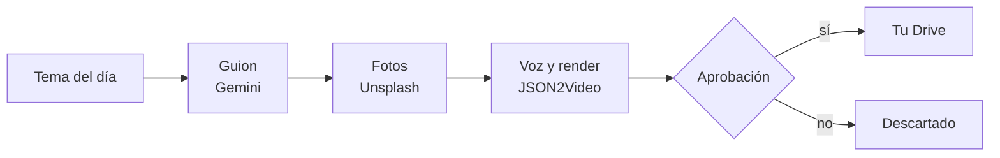
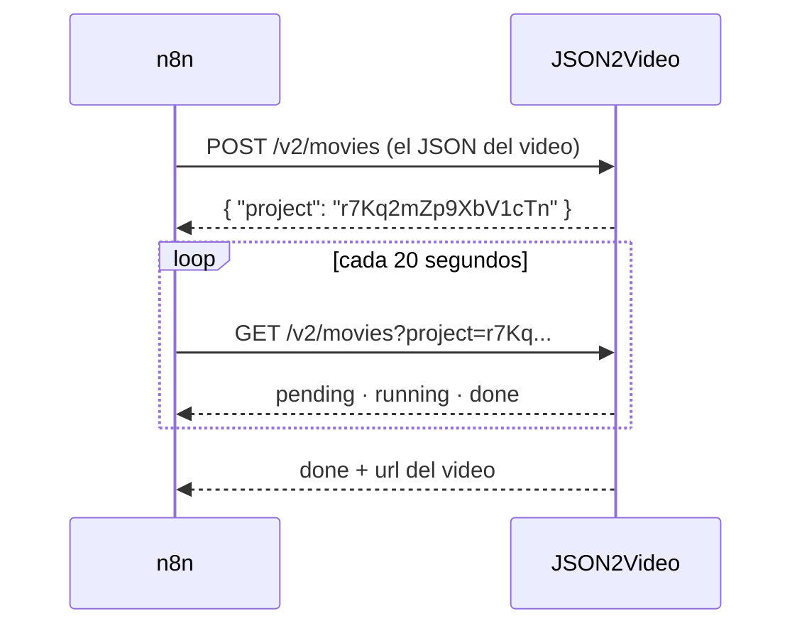

# Seminario de Automatización

<div class="wire"><span></span></div>

<div class="text-xl">Clase 7</div>
<div class="lead mt-1">Procesos asincrónicos y automatización como producto.</div>

<div class="mute text-sm mt-14">
Tecnicatura Universitaria en Programación<br>
Gonzalo Bechara Balaldi
</div>

<!--
Hoy el flujo no procesa algo que llega: fabrica algo nuevo, todos los días,
solo. Arrancar mostrando un video terminado antes de explicar nada.
-->

---

## De dónde venimos

<div class="grid grid-cols-2 gap-8 mt-8">

<div>
<div class="ok text-sm mb-3">La clase pasada</div>
<ul class="mute text-sm">
<li>Recuperar antes de responder</li>
<li>Tres compuertas antes de mandar algo</li>
<li>Una persona aprueba las acciones con efecto</li>
</ul>
</div>

<div>
<div class="sig text-sm mb-3">Hoy</div>
<ul class="mute text-sm">
<li>Un flujo que fabrica un video entero por día</li>
<li>Esperar algo que tarda minutos, o a una persona que tarda horas</li>
<li>Cuánto cuesta cada pieza</li>
</ul>
</div>

</div>

<div class="box box-warn mt-10 text-sm">
Hasta hoy, cada llamada respondía en un par de segundos. Hoy hay una que tarda dos minutos y otra que tarda <b>lo que tarde una persona en mirar el celular</b>.
</div>

---
layout: section
class: section-break
---

# Fabricar

<div class="wire"><span></span></div>

---

## Lo más automático posible



<div class="grid grid-cols-3 gap-4 mt-8 text-sm">
<div class="box"><b class="sig">Entra</b><div class="mute mt-1">Una lista de temas de tu canal.</div></div>
<div class="box"><b class="sig">Sale</b><div class="mute mt-1">Un video vertical de 30 segundos, con voz, fotos y subtítulos.</div></div>
<div class="box"><b class="sig">Interviene</b><div class="mute mt-1">Una persona, una vez, con un clic.</div></div>
</div>

<!--
"Lo más automático posible" no es "sin personas". Es que la persona haga solo
lo que no se puede delegar: decidir si eso sale con su nombre.
-->

---

## Tres servicios

| Servicio | Qué hace | Gratis hasta |
| --- | --- | --- |
| **Gemini** | Escribe el guion | La cuota diaria del nivel gratuito |
| **Unsplash** | Pone las fotos | 50 pedidos por hora, por aplicación |
| **JSON2Video** | Pone la voz, los subtítulos y renderiza | **600 segundos de video, una sola vez** |

<div class="box box-warn mt-8 text-sm">
El recurso escaso no es la plata, es <b>el render</b>. Cada prueba sale plata.
</div>

<div class="mute text-xs mt-4">
El video gratuito sale con marca de agua. Sirve para aprender, no para un canal real.
</div>

---

## El video es un JSON

<div class="grid grid-cols-2 gap-8 mt-4">

<div v-pre>

```json
{
  "resolution": "instagram-story",
  "scenes": [
    {
      "elements": [
        { "type": "image",
          "src": "https://images.unsplash...",
          "resize": "cover", "zoom": 3 },
        { "type": "voice",
          "text": "¿Sabías que un delfín...",
          "voice": "es-AR-ElenaNeural" }
      ]
    }
  ],
  "elements": [
    { "type": "subtitles", "language": "es" }
  ]
}
```

</div>

<div class="text-sm">

<div class="box box-sig">
Cada escena es una foto y una frase. La escena dura lo que tarda la voz en decirla.
</div>

<div class="box mt-4">
Los subtítulos se generan solos a partir del audio. No hay que sincronizar nada.
</div>

<div class="box box-ok mt-4">
<b class="ok">Se paga recién cuando se manda a renderizar.</b> Por eso todo lo que se pueda validar, se valida antes.
</div>

</div>

</div>

---
layout: section
class: section-break
---

# Esperar

<div class="wire"><span></span></div>

---

## Sincrónico y asincrónico

<div class="grid grid-cols-2 gap-8 mt-8 text-sm">

<div class="box">
<b class="sig">Sincrónico</b>
<div class="mute mt-2">Pedís y te quedás con la conexión abierta hasta que llega la respuesta. Todo lo que hicimos hasta hoy.</div>
<div class="mute mt-3 text-xs">Como pedir un trago en la barra.</div>
</div>

<div class="box">
<b class="sig">Asincrónico</b>
<div class="mute mt-2">Pedís, te dan un número, cortás, y más tarde preguntás si ya está.</div>
<div class="mute mt-3 text-xs">Como dejar ropa en la tintorería.</div>
</div>

</div>

<div class="box box-warn mt-8 text-sm">
Un render de dos minutos no entra en una conexión HTTP: algún intermediario la corta antes. Cuando el trabajo tarda, el servicio te da un identificador para que después preguntes como viene el trabajo.
</div>

<!--
Preguntar qué servicios conocen que funcionen así. Aparecen solos: pagos,
envíos, exportaciones de datos, generación de imágenes.
-->

---

## Pedido, identificador, consulta




---

## Sondear sin quedarse para siempre

<div class="grid grid-cols-2 gap-8 mt-6">

<div class="text-sm">

<div class="tramo"><b>1</b><span><b>Esperar</b> 20 segundos</span><em>Wait</em></div>
<div class="tramo"><b>2</b><span><b>Consultar</b> el estado con el identificador</span><em>HTTP</em></div>
<div class="tramo"><b>3</b><span>Listo, fallido o en curso</span><em>Switch</em></div>
<div class="tramo"><b>4</b><span>¿Quedan vueltas? Volver al paso 1</span><em>IF</em></div>

</div>

<div class="text-sm">

<div class="box box-warn">
<b class="warn">Un lazo necesita una salida</b>
<div class="mute mt-2">Si el render se traba, el flujo pregunta para siempre. <code>$runIndex</code> cuenta cuántas veces pasó el IF, y a la vuelta 18 se corta.</div>
</div>

<div class="box box-sig mt-4">
<b class="sig">Tres salidas, no dos</b>
<div class="mute mt-2">Listo, fallido y <b>demorado</b>. El demorado no es un error del servicio: es que decidimos dejar de esperar.</div>
</div>

</div>

</div>

<!--
Señalar que el demorado probablemente se cobre igual: el servicio sigue
renderizando aunque nosotros dejemos de preguntar. Pedirlo de nuevo es pagarlo
dos veces.
-->

---

## Cada cuánto preguntar

<div class="grid grid-cols-3 gap-4 mt-10 text-sm">

<div class="box box-warn">
<b class="warn">Cada segundo</b>
<div class="mute mt-2">Ciento veinte pedidos para un render de dos minutos. Gastás cuota y el servicio te limita.</div>
</div>

<div class="box box-ok">
<b class="ok">Cada 20 segundos</b>
<div class="mute mt-2">Seis o siete pedidos. Te enterás, como mucho, veinte segundos tarde.</div>
</div>

<div class="box box-warn">
<b class="warn">Cada diez minutos</b>
<div class="mute mt-2">Un pedido. Pero el video estuvo listo ocho minutos antes de que te enteraras.</div>
</div>

</div>

<div class="box box-sig mt-8 text-sm">
La alternativa a preguntar es que <b class="sig">te avisen</b>: muchos servicios llaman a un webhook tuyo cuando terminan.
</div>

---

## Esperar a una persona

<div class="grid grid-cols-2 gap-8 mt-6 text-sm">

<div>

El nodo de **Gmail** tiene una operación que manda el correo y deja la ejecución en pausa: **Send and Wait for Response**.

<div class="mute mt-3">El correo llega con dos botones, Aprobar y Descartar. El clic despierta la ejecución, que sigue con la respuesta:</div>

<div v-pre class="mt-3">

```json
{ "data": { "approved": true } }
```

</div>

</div>

<div>

<div class="box box-ok">
<b class="ok">Mientras espera, no ocupa nada</b>
<div class="mute mt-1">n8n la guarda en la base y la retoma cuando llega el clic. Puede esperar horas, o días.</div>
</div>

<div class="box box-warn mt-4">
<b class="warn">Siempre con un plazo</b>
<div class="mute mt-1">Si nadie decide en un día, sigue sola sin respuesta, y eso es una tercera rama: vencido.</div>
</div>

</div>

</div>

<div class="box box-sig mt-6 text-sm">
Una persona es el proceso asincrónico más lento de todos, y se programa igual: <b class="sig">pedido, espera con plazo, respuesta</b>.
</div>

---
layout: section
class: section-break
---

# Producto

<div class="wire"><span></span></div>


---

## Escalar no es multiplicar

<div class="lead mt-4">
¿Qué pasa si en vez de un video por día hacemos diez?
</div>

<div class="grid grid-cols-2 gap-x-10 gap-y-3 mt-8 text-sm">

<div class="box"><b class="warn">Las fotos</b><div class="mute mt-1">Cuatro búsquedas y cuatro avisos de uso por video. Al sexto video en una hora, Unsplash dice que no.</div></div>
<div class="box"><b class="warn">Los créditos</b><div class="mute mt-1">La cuenta gratuita se termina en dos días en vez de en tres semanas.</div></div>
<div class="box"><b class="warn">Los temas</b><div class="mute mt-1">Una lista de cien temas dura diez días. Alguien tiene que seguir alimentándola.</div></div>
<div class="box"><b class="warn">La persona que aprueba</b><div class="mute mt-1">Mirar diez videos por día es un trabajo. Y empieza a aprobar sin mirar.</div></div>

</div>

<div class="box box-sig mt-8 text-sm">
El cuello de botella de una fábrica de contenido <b class="sig">no es la máquina</b>. Es la persona que decide qué sale.
</div>

---

## Curaduría en capas

<div class="grid grid-cols-3 gap-4 mt-8 text-sm">

<div class="box box-ok">
<b class="ok">El código</b>
<div class="mute mt-2">Gratis, instantáneo. Vacíos, repetidos, ya publicados, demasiado largos, promesas de salud.</div>
</div>

<div class="box box-sig">
<b class="sig">El modelo</b>
<div class="mute mt-2">Centavos, segundos. Lo que se entiende leyendo: un tema que le atribuye algo a una persona real.</div>
</div>

<div class="box box-warn">
<b class="warn">La persona</b>
<div class="mute mt-2">Cara, horas. Lo que no se ve en el texto: la foto equivocada, el tono, el dato dudoso.</div>
</div>

</div>

<div class="box mt-8 text-sm">
Cada capa existe para que la siguiente reciba menos. Si a la persona le llegan diez videos por día y tres son de temas repetidos, <b>falló el código, no la persona</b>.
</div>

<div class="box mt-4 text-sm">
Es el mismo principio de la clase 5: guardia determinista antes de
preguntarle al modelo.
</div>

---

## Los términos de uso

<div class="grid grid-cols-2 gap-6 mt-6 text-sm">

<div class="box">
<b class="sig">Unsplash</b>
<ul class="mute mt-2">
<li>La foto se usa desde su dirección, no se copia</li>
<li>Se avisa cada vez que se usa una</li>
<li>Se nombra al fotógrafo, con enlace</li>
</ul>
</div>

<div class="box">
<b class="sig">Las plataformas</b>
<ul class="mute mt-2">
<li>Piden declarar el contenido generado con IA que parece real</li>
<li>Penalizan el contenido repetitivo hecho en serie</li>
<li>Cambian sus reglas sin avisarte</li>
</ul>
</div>

</div>

<div class="box box-warn mt-8 text-sm">
Automatizar no te exime de leer los términos. Te obliga a leerlos antes, porque si hay un error, se repite en cada ejecución.
</div>

<!--
Por eso el video termina con una escena de créditos: la atribución va
adentro del video, no solo en la descripción que nadie lee.
-->

---
layout: section
class: section-break
---

# Caso de uso

<div class="wire"><span></span></div>

---

## Tu propio canal

<div class="lead mt-4">
Cada uno elige un nicho. El flujo es el mismo; los temas y el tono son tuyos.
</div>

<div class="grid grid-cols-2 gap-8 mt-8 text-sm">

<div class="box">
<b class="sig">El canal</b>
<div class="mute mt-2">Tres campos: el nombre, el público y el tono. Es lo único que lee el modelo además del tema.</div>
<div class="mt-3 mute text-xs">El ejemplo: "Ciencia en 30 segundos".</div>
</div>

<div class="box">
<b class="sig">Los temas</b>
<div class="mute mt-2">Diez, en una lista. Uno por día.</div>
</div>

</div>

<div class="box box-warn mt-8 text-sm">
Elijan algo que puedan juzgar. Si no sabés nada del tema, no vas a poder aprobar ni rechazar con criterio, y la tercera capa de curaduría desaparece.
</div>

<!--
Dar cinco minutos para elegir nicho y escribir cinco temas propios. Que al
menos uno sea un caso límite a propósito, para ver qué capa lo atrapa.
-->

---

## Qué hay que producir

<div class="mt-6 text-sm">

<div class="tramo"><b>1</b><span>Los temas <b>curados</b>, con el motivo de cada descarte</span><em>gratis</em></div>
<div class="tramo"><b>2</b><span>Un <b>guion validado</b>: cuatro escenas, unos 30 segundos, búsquedas en inglés</span><em>Gemini</em></div>
<div class="tramo"><b>3</b><span>Una <b>foto por escena</b>, sin repetir, con su autor</span><em>Unsplash</em></div>
<div class="tramo"><b>4</b><span>El <b>render</b>, pedido y sondeado hasta que termina o se cansa</span><em>asincrónico</em></div>
<div class="tramo"><b>5</b><span>Una fila en el <b>libro de costos</b> y un enlace para aprobar</span><em>producto</em></div>

</div>

<div class="box box-sig mt-8 text-sm">
La pregunta con la que se cierra: <b class="sig">¿cuánto cuesta un video de tu canal, y quién es el cuello de botella?</b>
</div>

---
layout: section
class: section-break
---

# Práctica guiada

<div class="wire"><span></span></div>

---

## Paso 0 — Dos cuentas nuevas

<div class="mt-6 text-sm">

<div class="tramo"><b>a</b><span><b>Gemini</b>: la credencial de las clases 5 y 6</span><em>ya la tienen</em></div>
<div class="tramo"><b>b</b><span><b>Unsplash</b>: unsplash.com/developers → New Application → Access Key</span><em>nueva</em></div>
<div class="tramo"><b>c</b><span>Header Auth: nombre <code>Authorization</code>, valor <code>Client-ID</code> + la clave (separados por espacio)</span><em>credencial</em></div>
<div class="tramo"><b>d</b><span><b>JSON2Video</b>: registrarse → API Keys</span><em>nueva</em></div>
<div class="tramo"><b>e</b><span>Header Auth: nombre <code>x-api-key</code>, valor la clave</span><em>credencial</em></div>

</div>

<div class="box box-warn mt-8 text-sm">
En Unsplash la palabra <code>Client-ID</code> y el espacio van <b class="warn">adentro del valor</b>. Sin eso, la respuesta es un 401.
</div>

---

## Paso 1 — Curar y escribir

<div class="mt-6 text-sm">

<div class="tramo"><b>a</b><span>Cambiar <b>El canal</b> y <b>Temas del canal</b> por los propios</span><em>tu nicho</em></div>
<div class="tramo"><b>b</b><span>Ejecutar el template hasta <b>Armar el video</b></span><em>gratis</em></div>
<div class="tramo"><b>c</b><span>Leer los descartes de <b>Curar temas</b>: ¿quedó afuera lo que tenía que quedar?</span><em>verificar</em></div>
<div class="tramo"><b>d</b><span>Abrir el campo <code>movie</code>: es el video entero, antes de pagar nada</span><em>mirar</em></div>

</div>

<div class="box box-ok mt-8 text-sm">
Hasta acá no se gastó ni un crédito de render. Este es el momento de corregir el guion, el tono o las búsquedas: <b class="ok">después cuesta</b>.
</div>

---

## Paso 2 — Pedir y sondear

<div class="grid grid-cols-2 gap-8 mt-6 text-sm">

<div>

<div class="tramo"><b>a</b><span>HTTP <b>POST</b> con el campo <code>movie</code> como cuerpo</span></div>
<div class="tramo"><b>b</b><span>IF: ¿vino <code>success</code> y un <code>project</code>?</span></div>
<div class="tramo"><b>c</b><span><b>Wait</b> de 20 segundos</span></div>
<div class="tramo"><b>d</b><span>HTTP <b>GET</b> con el <code>project</code></span></div>
<div class="tramo"><b>e</b><span>Switch por <code>movie.status</code>, con salida por defecto</span></div>
<div class="tramo"><b>f</b><span>IF <code>$runIndex &lt; 18</code>, cableado de vuelta al Wait</span></div>

</div>

<div>

<div class="box box-warn">
<b class="warn">El identificador en la segunda vuelta</b>
<div class="mute mt-2">En la primera vuelta llega en el item. En la segunda ya no: lo que llega es la respuesta de la consulta anterior. Se lee siempre del nodo del pedido.</div>
</div>

<div v-pre class="mt-4">

```
{{ $('Pedir el render').first().json.project }}
```

</div>

</div>

</div>

---

## Paso 3 — No pagar dos veces

<div class="grid grid-cols-2 gap-8 mt-8 text-sm">

<div class="box box-sig">
<b class="sig">Fijar el primer render bueno</b>
<div class="mute mt-2">Cuando <b>Consultar estado</b> devuelva <code>done</code>, fijar su salida. Lo que sigue se arma contra ese resultado, sin volver a renderizar.</div>
</div>

<div class="box box-ok">
<b class="ok">Y mientras tanto</b>
<div class="mute mt-2">Avisarle a Unsplash que las fotos se usaron, y registrar el costo de la pieza en el libro.</div>
</div>

</div>

<div class="box box-warn mt-8 text-sm">
Probar cinco veces la aprobación renderizando cada vez son ciento cincuenta segundos: <b class="warn">un cuarto de la cuenta</b>, gastado en probar un botón.
</div>

<!--
Es la clase 4 otra vez: los datos fijados hacen al flujo inmune a internet.
Hoy además lo hacen barato.
-->

---

## Paso 4 — Aprobar desde un correo

<div class="mt-6 text-sm">

<div class="tramo"><b>a</b><span>Gmail → <b>Send and Wait for Response</b>, a <code>correo_revision</code> de <b>El canal</b></span><em>pedido</em></div>
<div class="tramo"><b>b</b><span>Dos botones, Aprobar y Descartar, y un límite de espera de un día</span><em>pausa</em></div>
<div class="tramo"><b>c</b><span>Leer <code>data.approved</code>: sin <code>data</code>, es que se venció el plazo</span><em>decisión</em></div>
<div class="tramo"><b>d</b><span>Switch: aprobado, rechazado, vencido</span><em>tres ramas</em></div>

</div>

<div class="box box-sig mt-8 text-sm">
Para probar la rama vencida sin esperar un día, bajar el límite a un minuto y no tocar nada. <b class="sig">Una rama que nunca se ejecutó no está probada.</b>
</div>

---

## Paso 5 — Que corra solo

<div class="grid grid-cols-2 gap-8 mt-8 text-sm">

<div class="box">
<b class="sig">El disparador</b>
<div class="mute mt-2">Un Schedule Trigger todos los días a las 9, cableado al mismo nodo que la ejecución manual. Y activar el flujo.</div>
</div>

<div class="box box-warn">
<b class="warn">La memoria del flujo</b>
<div class="mute mt-2">Qué temas ya salieron se guarda en los datos estáticos del flujo. n8n solo los guarda en ejecuciones activadas: <b>a mano vas a ver siempre el mismo tema</b>.</div>
</div>

</div>

<div class="box box-ok mt-8 text-sm">
A partir de acá el flujo trabaja solo. Lo que te queda es abrir un enlace por día.
</div>

---

## Lo que probablemente falle

<div class="grid grid-cols-2 gap-6 mt-8 text-sm">

<div class="box box-warn"><b>El lazo no termina nunca</b><div class="mute mt-1">Falta el IF con <code>$runIndex</code>, o está cableado antes del Wait en vez de después del Switch.</div></div>
<div class="box box-warn"><b>"project" vacío en la segunda vuelta</b><div class="mute mt-1">Se leyó de <code>$json</code> en vez del nodo del pedido.</div></div>
<div class="box box-warn"><b>Un 403 de Unsplash</b><div class="mute mt-1">Puede ser la clave o el límite de 50 por hora. Mismo código, dos problemas: leer el mensaje.</div></div>
<div class="box box-warn"><b>Fotos que no tienen que ver</b><div class="mute mt-1">Las búsquedas salieron en castellano, o son demasiado abstractas para una foto.</div></div>
<div class="box box-warn"><b>Render con error</b><div class="mute mt-1">Un nombre de voz mal escrito o un campo de más. No se cobra, y el mensaje dice cuál.</div></div>
<div class="box box-warn"><b>Se terminaron los créditos</b><div class="mute mt-1">Se probó la aprobación renderizando cada vez, sin fijar la salida.</div></div>

</div>

<!--
La segunda es la más frecuente y la más instructiva: es exactamente la
diferencia entre el item que llega y el dato que necesitás.
-->

---

## Cierre

<div class="grid grid-cols-2 gap-10 mt-8">

<div>
<div class="sig text-sm mb-3">Hoy vimos</div>
<ul class="mute text-sm">
<li>Pedido, identificador y consulta</li>
<li>Un lazo de sondeo con salida</li>
<li>Una ejecución que espera a una persona, con plazo</li>
<li>El costo por pieza y dónde se rompe al escalar</li>
<li>Curaduría en capas, de la más barata a la más cara</li>
</ul>
</div>

<div>
<div class="warn text-sm mb-3">Qué falló durante la práctica</div>
<div class="box box-warn text-sm mute">
Repaso en vivo de los errores que aparecieron hoy en el aula.
</div>
</div>

</div>

<div class="box box-sig mt-8 text-sm">
<b class="sig">La pregunta del principio</b>
<div class="mute mt-1">
¿Cuánto cuesta un video de tu canal, y quién es el cuello de botella? Si la respuesta a la segunda no es "yo", todavía no lo pusiste a producir en serio.
</div>
</div>

<!--
Que cada uno diga su número. Dejar el video aprobado guardado: la clase que
viene lo bajamos a su Drive y ponemos el flujo a operar de verdad.
-->
