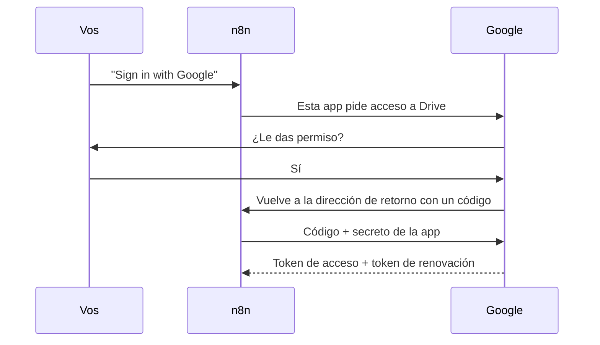
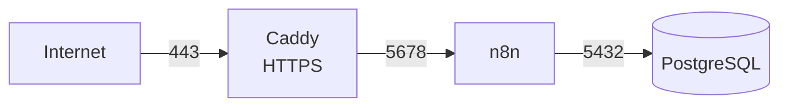

# Seminario de Automatización

<div class="wire"><span></span></div>

<div class="text-xl">Clase 8</div>
<div class="lead mt-1">Operar una automatización: acceso delegado, fallas y alojamiento.</div>

<div class="mute text-sm mt-14">
Tecnicatura Universitaria en Programación<br>
Gonzalo Bechara Balaldi
</div>

<!--
Última clase. La fábrica de la clase pasada funciona, pero solo mientras
alguien mira el editor. Hoy la ponemos a trabajar de verdad.
-->

---

## De dónde venimos

<div class="grid grid-cols-2 gap-8 mt-8">

<div>
<div class="ok text-sm mb-3">La clase pasada</div>
<ul class="mute text-sm">
<li>Una fábrica de videos que corre todas las mañanas</li>
<li>Un render asincrónico, sondeado con salida</li>
<li>Una persona que aprueba desde un correo</li>
<li>Un libro de costos</li>
</ul>
</div>

<div>
<div class="sig text-sm mb-3">Lo que le falta</div>
<ul class="mute text-sm">
<li>Conectamos Gmail con OAuth2 siguiendo una receta, sin saber qué firmamos</li>
<li>El video aprobado se pierde: la dirección es temporal</li>
<li>Si falla a las 9 de la mañana, nadie se entera</li>
</ul>
</div>

</div>

<div class="box box-warn mt-10 text-sm">
Una automatización que solo funciona mientras la mirás <b class="warn">es una demostración</b>, no una automatización.
</div>

---
layout: section
class: section-break
---

# Delegar

<div class="wire"><span></span></div>

---

## Una clave no alcanza

<div class="grid grid-cols-2 gap-8 mt-8 text-sm">

<div class="box">
<b class="sig">Clave de API</b>
<div class="mute mt-2">Identifica a <b>tu aplicación</b> ante un servicio. Unsplash, JSON2Video, Gemini, el gist de la clase 4.</div>
<div class="mute mt-3 text-xs">Sirve cuando los datos son del servicio, o tuyos dentro de él.</div>
</div>

<div class="box">
<b class="sig">Acceso delegado</b>
<div class="mute mt-2">Tu aplicación actúa <b>en nombre de una persona</b>, sobre las cosas de esa persona: su Drive, su correo.</div>
<div class="mute mt-3 text-xs">La persona da permiso una vez, para algo concreto, y lo puede revocar.</div>
</div>

</div>

<div class="box box-sig mt-8 text-sm">
La clase pasada, el flujo mandó correos desde tu Gmail sin saber tu contraseña. Eso es OAuth2: hoy vemos qué pasó, y lo usamos para que <b class="sig">guarde un archivo en tu Drive</b>.
</div>

---

## El ida y vuelta de OAuth2



<div class="mute text-sm mt-4">
El token de acceso dura una hora. El de renovación le permite a n8n pedir otro sin volver a preguntarte.
</div>

<!--
Hacerlo en vivo con la instancia proyectada. El momento en que Google
muestra la pantalla de permisos es el que hay que señalar: ahí se firma qué
puede hacer el flujo.
-->

---

## Las cuatro piezas

<div class="grid grid-cols-2 gap-x-10 gap-y-3 mt-8 text-sm">

<div class="box"><b class="sig">El cliente</b><div class="mute mt-1">Un identificador y un secreto. Son la identidad de tu aplicación ante Google, no la tuya.</div></div>
<div class="box"><b class="sig">La dirección de retorno</b><div class="mute mt-1">Adonde vuelve Google con el código. Tiene que coincidir letra por letra, y ser HTTPS.</div></div>
<div class="box"><b class="sig">Los alcances</b><div class="mute mt-1">Qué se pide: leer el correo, mandar correo, ver archivos, crear archivos.</div></div>
<div class="box"><b class="sig">La pantalla de consentimiento</b><div class="mute mt-1">Lo que ve la persona antes de aceptar: quién pide y qué pide.</div></div>

</div>

<div class="box box-warn mt-8 text-sm">
La dirección de retorno es el motivo por el que la instancia necesita una dirección pública con HTTPS. <b class="warn">Sin eso, OAuth2 no tiene adónde volver.</b>
</div>

---

## Pedir lo mínimo

<div class="lead mt-4">
El mismo principio del token de la clase 4: el permiso que alcanza, y ninguno más.
</div>

<div class="grid grid-cols-2 gap-8 mt-8 text-sm">

<div class="box box-ok">
<b class="ok">Lo que necesita la fábrica</b>
<div class="mute mt-2">Crear archivos en una carpeta y mandar un correo.</div>
</div>

<div class="box box-warn">
<b class="warn">Lo que pide la credencial de n8n</b>
<div class="mute mt-2">Acceso a todo el Drive. No se puede achicar desde la credencial.</div>
</div>

</div>

<div class="box box-sig mt-8 text-sm">
Cuando la herramienta pide más de lo necesario, la decisión es tuya: aceptarlo sabiendo qué se firmó, o usar una cuenta aparte para la automatización. <b class="sig">Lo que no se puede es no saberlo.</b>
</div>

---

## Modo de prueba: siete días

<div class="grid grid-cols-2 gap-8 mt-8 text-sm">

<div class="box">
<b class="sig">Tu app está en "Prueba"</b>
<div class="mute mt-2">Solo pueden darle permiso las cuentas que agregues como usuarios de prueba. Para uso propio, alcanza.</div>
</div>

<div class="box box-warn">
<b class="warn">Y tiene fecha de vencimiento</b>
<div class="mute mt-2">En modo prueba, el token de renovación vence a los siete días. El octavo día, la fábrica deja de poder guardar.</div>
</div>

</div>

<div class="box box-sig mt-8 text-sm">
Es la falla perfecta para esta clase: no aparece en la práctica, aparece <b class="sig">una semana después, a las 9 de la mañana, sin nadie mirando</b>. Hoy armamos lo que hace que te enteres.
</div>

<!--
Si pasó una semana desde la clase 7, la credencial de Gmail ya venció en
varias máquinas. Señalarlo acá: no es teoría, les acaba de pasar.

La salida para un uso real es publicar la app, que con permisos sensibles
pide una verificación de Google. Para un proyecto personal: reconectar la
credencial una vez por semana, y que el flujo de errores avise cuando toca.
-->

---
layout: section
class: section-break
---

# Entregar

<div class="wire"><span></span></div>

---

## La dirección no es el archivo

<div class="grid grid-cols-3 gap-4 mt-8 text-sm">

<div class="box">
<b class="sig">1. Bajar</b>
<div class="mute mt-2">Un HTTP a la dirección del video, con la respuesta en modo <b>archivo</b>. El item pasa a tener un binario.</div>
</div>

<div class="box">
<b class="sig">2. Subir</b>
<div class="mute mt-2">El nodo de Google Drive toma ese binario y lo guarda con fecha y título.</div>
</div>

<div class="box">
<b class="sig">3. La ficha</b>
<div class="mute mt-2">Un texto al lado: descripción, hashtags y los créditos de las fotos.</div>
</div>

</div>

<div class="box box-warn mt-8 text-sm">
La dirección que devuelve JSON2Video es temporal. Guardar el enlace no es guardar el video: <b class="warn">si no está en un lugar tuyo, no lo tenés</b>.
</div>

<div class="mute text-xs mt-4">
La ficha existe por la clase pasada: la atribución tiene que viajar con el video, no quedar en un nodo de n8n.
</div>

---
layout: section
class: section-break
---

# Operar

<div class="wire"><span></span></div>

---

## Probar no es operar

| | Ejecución manual | Ejecución de producción |
| --- | --- | --- |
| La dispara | Vos, desde el editor | El Schedule, un webhook, una reanudación |
| Hay alguien mirando | Sí | No |
| Guarda los datos estáticos | No | Sí |
| Dispara el flujo de errores | **No** | **Sí** |
| Dónde ves el resultado | En el lienzo | En la lista de ejecuciones, si la abrís |

<div class="box box-sig mt-8 text-sm">
Todo lo que hicimos en el seminario fue en la columna de la izquierda. Hoy pasamos a la de la derecha, donde <b class="sig">el único que mira es lo que vos dejaste armado</b>.
</div>

---

## Cuando falla y nadie mira

<div class="grid grid-cols-2 gap-8 mt-6">

<div class="text-sm">

Un **flujo de errores** es un flujo aparte que empieza con un **Error Trigger**. Cualquier flujo puede elegirlo en *Settings → Error workflow*.

<div class="box mt-4">
Cuando el flujo principal falla en producción, n8n llama al de errores y le pasa qué flujo falló, en qué nodo, el mensaje y el enlace a la ejecución.
</div>

</div>

<div v-pre>

```json
{
  "execution": {
    "url": "https://.../executions/1287",
    "lastNodeExecuted": "Detener con error",
    "error": { "message": "error_de_nodo: 401..." },
    "mode": "trigger"
  },
  "workflow": {
    "name": "Clase 8 - Fabrica en operacion"
  }
}
```

</div>

</div>

<div class="box box-warn mt-6 text-sm">
Si el aviso usa el mismo servicio que suele fallar, falla junto con él. <b class="warn">El aviso tiene que ir por otro camino.</b>
</div>

---

## Atrapado no es avisado

<div class="grid grid-cols-2 gap-8 mt-8 text-sm">

<div class="box box-warn">
<b class="warn">El problema</b>
<div class="mute mt-2">La clase 7 atrapa cada falla con una rama de error que arma un aviso prolijo. Para n8n, esa ejecución <b>terminó bien</b>. El flujo de errores nunca se entera.</div>
</div>

<div class="box box-ok">
<b class="ok">La solución</b>
<div class="mute mt-2">Al final de la rama de aviso, un nodo <b>Stop and Error</b> con el mensaje ya armado. La falla se maneja y además queda marcada como fallida.</div>
</div>

</div>

<div class="box box-sig mt-8 text-sm">
Manejar un error y avisar de un error son dos cosas distintas. Las ramas de error de las clases 4 a 7 hacían la primera. <b class="sig">Hoy hacemos la segunda.</b>
</div>

<!--
Preguntar cuántas de las ramas de error que armaron en el seminario
terminaban en un nodo vacío. Esa es la respuesta a "¿te enterarías?".
-->

---

## Qué mirar, y cuándo se rompe

<div class="mt-6 text-sm">

<div class="tramo"><b>1</b><span>Las <b>credenciales OAuth2</b> en modo prueba</span><em>a los 7 días</em></div>
<div class="tramo"><b>2</b><span>Los <b>créditos</b> de render: el libro dice cuántas piezas quedan</span><em>a las ~18 piezas</em></div>
<div class="tramo"><b>3</b><span>La <b>lista de temas</b></span><em>cuando se termina</em></div>
<div class="tramo"><b>4</b><span>Las <b>aprobaciones vencidas</b>: si se acumulan, nadie está mirando el correo</span><em>todos los días</em></div>
<div class="tramo"><b>5</b><span>La <b>base de datos</b> de n8n, que guarda cada ejecución</span><em>cuando se llena el disco</em></div>

</div>

<div class="box box-sig mt-8 text-sm">
Cada cosa de esta lista tiene una fecha en la que se rompe. <b class="sig">Operar es saberla antes</b>, no enterarse ese día.
</div>

---
layout: section
class: section-break
---

# Dónde vive n8n

<div class="wire"><span></span></div>

---

## En la nube o en un servidor propio

<div class="grid grid-cols-2 gap-8 mt-8 text-sm">

<div class="box">
<b class="sig">n8n en la nube</b>
<ul class="mute mt-2">
<li>Lo actualizan, lo respaldan, lo vigilan ellos</li>
<li>Se paga por ejecuciones</li>
<li>Los datos viven en sus servidores</li>
</ul>
</div>

<div class="box">
<b class="sig">Autoalojado</b>
<ul class="mute mt-2">
<li>Lo actualizás, lo respaldás y lo vigilás vos</li>
<li>Se paga el servidor, ejecutes lo que ejecutes</li>
<li>Los datos viven donde vos decidas</li>
</ul>
</div>

</div>

<div class="box box-warn mt-8 text-sm">
Autoalojar no es gratis: <b class="warn">el costo se paga en horas</b>, no en la factura. La instancia del seminario es autoalojada, y alguien tuvo que hacer todo lo que sigue.
</div>

---

## Qué hace falta



<div class="grid grid-cols-3 gap-4 mt-8 text-sm">
<div class="box"><b class="sig">Un dominio con HTTPS</b><div class="mute mt-1">Para los webhooks, la reanudación y OAuth2. Un proxy inverso pide y renueva el certificado.</div></div>
<div class="box"><b class="sig">Una base de datos</b><div class="mute mt-1">Flujos, credenciales y ejecuciones en espera. Con volumen persistente.</div></div>
<div class="box"><b class="sig">La dirección pública</b><div class="mute mt-1">n8n tiene que saber cómo lo ven desde afuera, o arma mal todos los enlaces.</div></div>
</div>

<!--
Mostrar el docker-compose de la carpeta autoalojado. Son tres servicios y
unas veinte variables; leerlo entero en voz alta lleva cinco minutos.
-->

---


# Práctica guiada

<div class="wire"><span></span></div>

---

## Qué hay que producir

<div class="mt-6 text-sm">

<div class="tramo"><b>1</b><span><b>Drive</b> en el mismo cliente OAuth2 de la clase pasada</span><em>delegar</em></div>
<div class="tramo"><b>2</b><span>El video aprobado y su ficha <b>en tu Drive</b></span><em>entregar</em></div>
<div class="tramo"><b>3</b><span>Un <b>flujo de errores</b>, y las fallas atrapadas que también avisen</span><em>avisar</em></div>
<div class="tramo"><b>4</b><span>El flujo <b>activado</b>, y una falla provocada en producción</span><em>operar</em></div>

</div>

<div class="box box-sig mt-8 text-sm">
La pregunta con la que se cierra el seminario: <b class="sig">si mañana a las 9 esto falla, ¿cómo te enterás?</b>
</div>

---

## Paso 0 — Drive en el mismo cliente

<div class="grid grid-cols-2 gap-8 mt-6 text-sm">

<div>

<div class="tramo"><b>a</b><span>En el proyecto de Google Cloud de la clase pasada, habilitar <b>Google Drive API</b></span></div>
<div class="tramo"><b>b</b><span>En n8n, credencial <b>Google Drive OAuth2 API</b> con el mismo identificador y secreto</span></div>
<div class="tramo"><b>c</b><span><b>Sign in with Google</b>, y esta vez <b>leer</b> la pantalla de permisos antes de aceptar</span></div>

</div>

<div>

<div class="box box-sig">
<b class="sig">Un cliente, dos credenciales</b>
<div class="mute mt-2">El cliente es la aplicación. Gmail y Drive son alcances distintos, y n8n guarda una credencial por servicio. No hace falta crear otro cliente.</div>
</div>

<div class="box box-warn mt-4">
<b class="warn">Lo que pide</b>
<div class="mute mt-2">Acceso a todo el Drive. Es la diapositiva de "Pedir lo mínimo", ahora en tu pantalla.</div>
</div>

</div>

</div>

---

## Paso 1 — Entregar

<div class="grid grid-cols-2 gap-8 mt-6 text-sm">

<div>

<div class="tramo"><b>a</b><span>HTTP a la dirección del video, respuesta en modo <b>File</b></span></div>
<div class="tramo"><b>b</b><span>Google Drive → <b>Upload</b>, en tu carpeta</span></div>
<div class="tramo"><b>c</b><span>Google Drive → <b>Create from text</b>, la ficha</span></div>
<div class="tramo"><b>d</b><span>Un Set final con los dos enlaces de Drive</span></div>

</div>

<div v-pre>

```
{{ $now.toFormat('yyyy-MM-dd') }} -
{{ $('Marcar el tema').first().json.titulo }}
```

<div class="box box-warn mt-4">
Si Drive se queja de que no encuentra el binario <code>data</code>, el HTTP bajó el video como texto. <b class="warn">Falta el modo File.</b>
</div>

</div>

</div>

---

## Paso 2 — Que avise

<div class="mt-6 text-sm">

<div class="tramo"><b>a</b><span>Flujo nuevo: <b>Error Trigger</b> → armar el mensaje → Gmail</span><em>el aviso</em></div>
<div class="tramo"><b>b</b><span>Probarlo con el error de ejemplo fijado en el Error Trigger</span><em>sin romper nada</em></div>
<div class="tramo"><b>c</b><span>En la fábrica: <i>Settings → Error workflow</i> → el flujo nuevo</span><em>conectar</em></div>
<div class="tramo"><b>d</b><span>Reemplazar <b>Notificar la falla</b> por un <b>Stop and Error</b></span><em>que se vea</em></div>

</div>

<div class="box box-sig mt-8 text-sm">
El flujo de errores <b class="sig">no se activa</b>: no tiene disparador propio. Lo llama n8n cuando hace falta.
</div>

---

## Paso 3 — Romperlo en producción

<div class="mt-6 text-sm">

<div class="tramo"><b>a</b><span>Sacarle una letra a la clave de Unsplash</span><em>falla barata</em></div>
<div class="tramo"><b>b</b><span>Poner el Schedule dos minutos más tarde que la hora actual</span><em>que dispare</em></div>
<div class="tramo"><b>c</b><span><b>Activar</b> el flujo, cerrar el editor y esperar</span><em>nadie mira</em></div>
<div class="tramo"><b>d</b><span>Tiene que llegar un correo con el error y el enlace a la ejecución</span><em>¿llegó?</em></div>
<div class="tramo"><b>e</b><span>Arreglar la clave y volver el Schedule a las 9</span><em>dejarlo andando</em></div>

</div>

<div class="box box-warn mt-8 text-sm">
Se rompe Unsplash y no otra cosa porque <b class="warn">falla antes del render</b>: la prueba no cuesta créditos.
</div>

---

## Lo que probablemente falle

<div class="grid grid-cols-2 gap-6 mt-8 text-sm">

<div class="box box-warn"><b>"Drive API has not been used in project"</b><div class="mute mt-1">Falta habilitar Drive en el proyecto de la clase pasada.</div></div>
<div class="box box-warn"><b>El video y la ficha en lugares distintos</b><div class="mute mt-1">La carpeta se eligió en uno solo de los dos nodos de Drive.</div></div>
<div class="box box-warn"><b>El correo de error no llega</b><div class="mute mt-1">La falla fue en una ejecución manual, o el flujo de errores no está elegido en Settings.</div></div>
<div class="box box-warn"><b>Falló, y tampoco llega</b><div class="mute mt-1">La rama de error la atrapó y terminó bien. Falta el Stop and Error.</div></div>
<div class="box box-warn"><b>Drive dice que no hay archivo</b><div class="mute mt-1">El HTTP no está en modo File: bajó el video como texto y no hay binario para subir.</div></div>
<div class="box box-warn"><b>Andaba, y una semana después no</b><div class="mute mt-1">Venció el token de renovación del modo prueba. Reconectar la credencial.</div></div>

</div>

<!--
La última no va a pasar hoy. Contarla igual: es la que les va a pasar con el
TP, y si el paso 4 quedó bien hecho, se van a enterar por correo.
-->

---

## Cierre

<div class="grid grid-cols-2 gap-10 mt-8">

<div>
<div class="sig text-sm mb-3">Hoy vimos</div>
<ul class="mute text-sm">
<li>Acceso delegado con OAuth2, y qué se firma al aceptar</li>
<li>Que guardar un enlace no es guardar el archivo</li>
<li>La diferencia entre probar y operar</li>
<li>Que manejar un error no es avisarlo</li>
<li>Qué hace falta para alojar n8n, y qué cuesta</li>
</ul>
</div>

<div>
<div class="warn text-sm mb-3">Qué falló durante la práctica</div>
<div class="box box-warn text-sm mute">
Repaso en vivo de los errores que aparecieron hoy en el aula.
</div>
</div>

</div>

<div class="box box-sig mt-8 text-sm">
<b class="sig">La pregunta del principio</b>
<div class="mute mt-1">
Si mañana a las 9 esto falla, ¿cómo te enterás? Si la respuesta es "me va a llegar un correo", el seminario cumplió. Si es "lo voy a mirar", todavía no.
</div>
</div>

<!--
Cerrar el seminario con esa pregunta aplicada al TP II de cada uno.
-->
